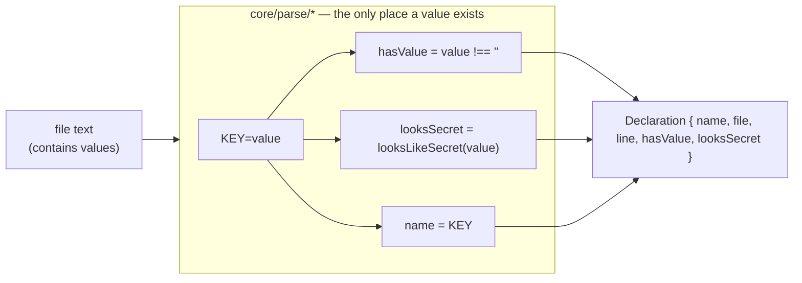
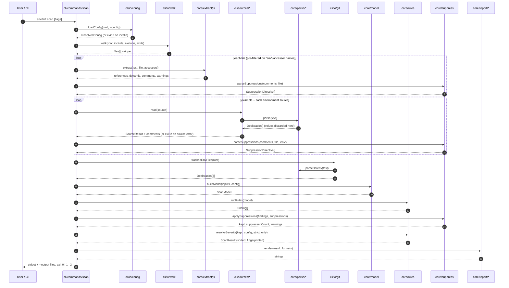
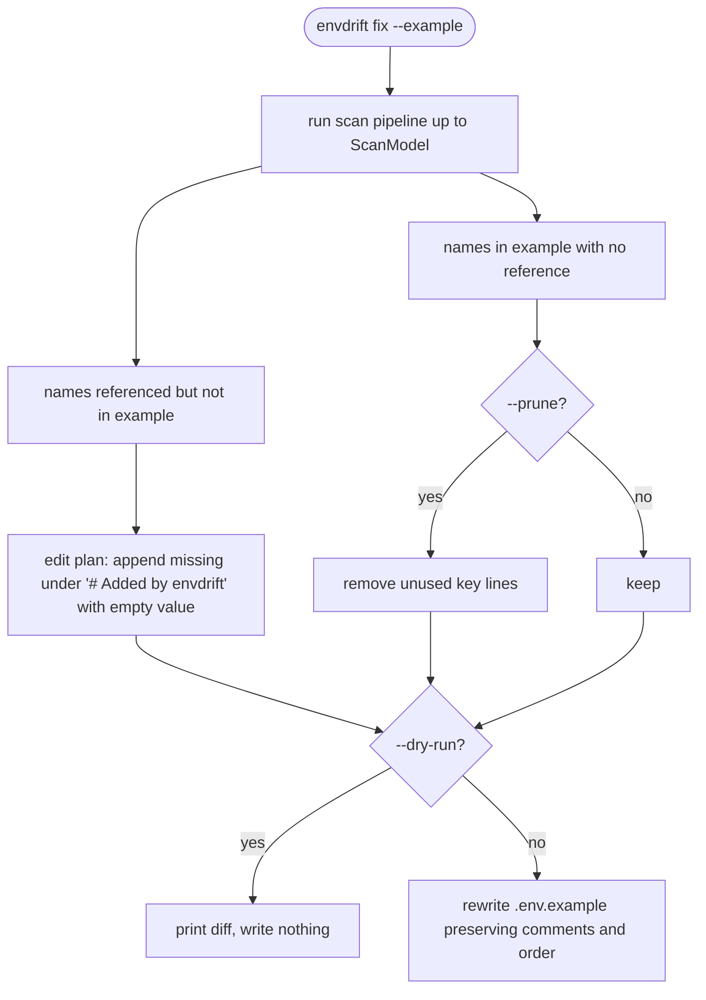

# Data Flow

> Implements [PRD §8 data flow](../prd.md#8-architecture). Types referenced here are defined in [data-model.md](data-model.md).

## 1. Scan pipeline

```
config ─▶ sources ─▶ ScanModel ─▶ rules ─▶ findings ─▶ suppression ─▶ severity resolution ─▶ reporters ─▶ exit code
```

| # | Stage | Package / module | Input | Output | Values present? |
|---|---|---|---|---|---|
| 1 | Load config | `cli/io/config.ts` → `core/config/schema.ts` | YAML text | `ResolvedConfig` | No |
| 2 | Discover files | `cli/io/walk.ts` | root, include/exclude, `.gitignore`, limits | file list + skipped count | No |
| 3 | Extract references | `core/extract/js.ts` | source text per file | `Reference[]`, `DynamicAccess[]`, comments, warnings | No |
| 3b | Parse suppressions | `core/suppress.ts` | code comments (from extract); `#` comment lines (from the `comments` returned with each source read, step 4) | `SuppressionDirective[]` | No |
| 4 | Read sources | `cli/sources/*` → `core/parse/*` | file text / SSM pages | `SourceRead` = `SourceResult` + `CommentLine[]` | **Yes, inside the parser only** — dropped before return |
| 5 | Tracked env files | `cli/io/git.ts` → `core/parse/dotenv.ts` | `git ls-files` + file text | `Declaration[][]` | Same as 4 |
| 6 | Build model | `core/model.ts` | all of the above + config | `ScanModel` (ignore list applied) | No |
| 7 | Run rules | `core/rules/ED00x.ts` | `ScanModel` | `Finding[]` (default severity) | No |
| 8 | Suppression | `core/suppress.ts` | findings + parsed ignore comments | kept findings, suppressed count, unmatched-suppression warnings | No |
| 9 | Severity resolution | `core/rules/index.ts` | findings + config `rules` + D3 + `--only` | final findings (`off` removed) | No |
| 10 | Sort + fingerprint | `core/rules/index.ts` | findings, `suppressed` count, total `durationMs` (set by the CLI) | sorted `ScanResult` | No |
| 11 | Report | `core/report/*` | `ScanResult` | string per format | No |
| 12 | Write + exit | `cli/commands/scan.ts` | strings, `--fail-on` | stdout / files, exit 0/1/2 | No |

### Where values are dropped (D6)



The value is a local variable inside the parser function. It is never assigned to any returned object, warning string, or error message. The AWS SSM adapter never requests decryption and sets `hasValue: true`, `looksSecret: false` without inspecting values. See [ADR 0006](adr/0006-values-never-leave-parsers.md).

## 2. `envdrift scan` sequence



Error handling per stage: [system/error-handling.md](../system/error-handling.md). A JS parse failure is a warning and counts as a skipped file; it never ends the scan.

## 3. `envdrift init`

```mermaid
flowchart TD
  start([envdrift init]) --> exists{config exists?}
  exists -- yes, no --force --> refuse[print message, exit 2]
  exists -- no / --force --> detect
  detect[detect: .env.example, Dockerfile, compose files,<br/>package.json deps → frontend prefixes] --> build[build config object]
  build --> validate[validate with core/config/schema]
  validate --> write[write envdrift.config.yaml]
  write --> print[print what was detected] --> done([exit 0])
```

Prefix detection: `next` → `NEXT_PUBLIC_`, `vite` → `VITE_`, `react-scripts` → `REACT_APP_`, `expo` → `EXPO_PUBLIC_`. See [functional/cli.md](../functional/cli.md).

## 4. `envdrift fix --example`



Note: `fix` must rewrite `.env.example` while preserving existing lines, including any values already there. It does this by line-level editing (keep untouched lines byte-for-byte; append or delete whole lines) so existing values are never parsed into a returned structure or printed. The diff in `--dry-run` shows only added/removed **key names**; for pruned lines it prints `KEY=<redacted>`. Proposal: confirm this diff format in [functional/cli.md](../functional/cli.md).

## 5. `envdrift explain <ruleId>`

Static lookup: rule ID → explain text (the same text as [rules.md](../rules.md), embedded at build time). Unknown ID → exit 2 with the list of valid IDs. No file I/O beyond stdout.

## 6. GitHub Action run

```mermaid
sequenceDiagram
  participant GH as GitHub runner
  participant A as action/src/index
  participant S as cli scan (programmatic)
  participant API as GitHub REST API
  GH->>A: inputs: config, fail-on, comment, sarif-file
  A->>S: scan({ formats: [markdown, json, sarif?] })
  S-->>A: ScanResult + rendered strings
  A->>GH: append markdown to $GITHUB_STEP_SUMMARY
  opt sarif-file set
    A->>GH: write SARIF to sarif-file path
  end
  opt comment = true and event is pull_request
    A->>API: list PR comments, find "<!-- envdrift-report -->"
    alt marker found
      A->>API: update comment
    else
      A->>API: create comment
    end
  end
  A-->>GH: setFailed if findings ≥ fail-on (exit 1); exit 2 on tool error
```

Details: [modules-action.md](modules-action.md), [functional/github-action.md](../functional/github-action.md).
