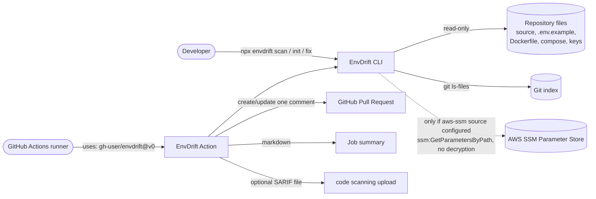
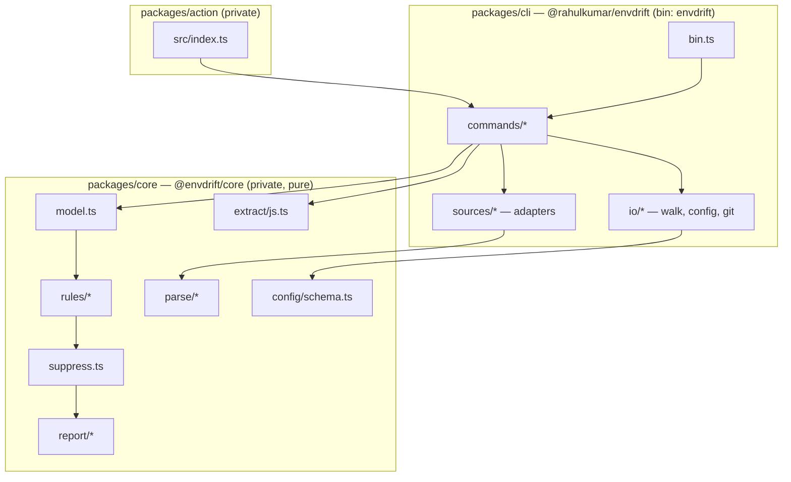

# Architecture Overview

> Replaces the `docs/architecture.md` named in PRD v2.0. Source of truth for *what* to build: [PRD §8](../prd.md#8-architecture). This document explains *how the pieces fit*.

## 1. Purpose

EnvDrift statically compares the environment variables a JS/TS codebase **reads** against what is **declared** in `.env.example` and in each configured environment (dotenv files, Dockerfiles, compose files, key lists, AWS SSM). It runs before deployment — locally as a CLI, in CI as a GitHub Action — and reports drift, unused declarations, exposed secrets and committed `.env` files.

It handles variable **names only**. Values are read by parsers, reduced to booleans (`hasValue`, `looksSecret`), and discarded ([ADR 0006](adr/0006-values-never-leave-parsers.md)).

## 2. System context



No other network traffic exists. No telemetry. See [system/security.md](../system/security.md).

## 3. Packages (containers)



| Package | npm name | Published | Role |
|---|---|---|---|
| `packages/core` | `@envdrift/core` | No — bundled into CLI by tsup | Pure logic: extraction, parsing, model, rules, suppression, reporters, config schema |
| `packages/cli` | `@rahulkumar/envdrift` (placeholder scope, [ADR 0011](adr/0011-scoped-npm-package-name.md)) | Yes | I/O adapters, commands, `envdrift` bin |
| `packages/action` | — | Via Git tag `v0` | Thin wrapper: runs the scan, writes job summary, upserts PR comment, writes SARIF |

## 4. Layering and the purity boundary

| Layer | May do | Must not do |
|---|---|---|
| **core** | Transform strings/objects into typed results | Import `fs`, `node:fs*`, `child_process`, `http(s)`, `net`, `@aws-sdk/*`; read `process.env`; print; exit |
| **cli** | Read files, run `git`, call SSM, print, set exit code | Contain rule logic or parse formats itself (delegates to core parsers) |
| **action** | Read Action inputs, call CLI programmatically, talk to GitHub API | Duplicate CLI logic |

Enforcement: ESLint `no-restricted-imports` and `no-restricted-properties` (`process.env`) on `packages/core/**`. A test (M1.1) asserts no exported type has a property named `value`.

Why: pure core makes rules trivially unit-testable with in-memory inputs, makes mutation testing fast, and keeps the "values never leave parsers" guarantee auditable in one place.

## 5. Repository layout

```
envdrift/
├── packages/
│   ├── core/          # pure: no fs, no network, no process.env reads
│   │   ├── src/
│   │   │   ├── extract/js.ts          # code → References, DynamicAccess
│   │   │   ├── parse/dotenv.ts        # dotenv text → Declarations
│   │   │   ├── parse/dockerfile.ts    # Dockerfile text → Declarations
│   │   │   ├── parse/compose.ts       # compose YAML text → Declarations + env_file paths
│   │   │   ├── parse/keys.ts          # plain key list → Declarations
│   │   │   ├── secrets.ts             # looksLikeSecret(value): boolean (called only by parsers)
│   │   │   ├── suppress.ts            # parse envdrift-ignore comments
│   │   │   ├── model.ts               # build ScanModel from inputs
│   │   │   ├── rules/ED001.ts … ED009.ts
│   │   │   ├── rules/index.ts         # registry, severity resolution
│   │   │   ├── report/table.ts | json.ts | markdown.ts | sarif.ts
│   │   │   ├── config/schema.ts       # zod schema + defaults
│   │   │   └── types.ts
│   │   └── test/
│   ├── cli/
│   │   ├── src/
│   │   │   ├── bin.ts
│   │   │   ├── commands/scan.ts | init.ts | explain.ts | fix.ts
│   │   │   ├── io/walk.ts | config.ts | git.ts
│   │   │   └── sources/dotenv.ts | dockerfile.ts | compose.ts | keys.ts | aws-ssm.ts
│   │   └── test/
│   └── action/
│       ├── action.yml
│       └── src/index.ts
├── fixtures/          # golden repos: <name>/ + expected.json
├── docs/              # functional/, architecture/, system/, PRD-mandated root docs
├── .claude/commands/
└── CLAUDE.md
```

Per-file detail: [modules-core.md](modules-core.md), [modules-cli.md](modules-cli.md), [modules-action.md](modules-action.md).

## 6. Technology stack

| Concern | Choice | Reason |
|---|---|---|
| Language | TypeScript strict, ESM, Node ≥ 20 | Type-safe data model; current LTS ([ADR 0010](adr/0010-node20-esm-only.md)) |
| JS/TS parsing | `@babel/parser` + hand-written walker | One parser for JS/JSX/TS/TSX, no type info needed ([ADR 0001](adr/0001-babel-parser-hand-written-walker.md)) |
| YAML | `yaml` | Compose files and config; preserves line numbers |
| Config validation | `zod` | Readable error paths, defaults in one place |
| CLI args | `commander` | Mature, small, subcommands |
| Ignore / globs | `ignore` + `picomatch` | gitignore semantics; fast glob matching without fs |
| AWS | `@aws-sdk/client-ssm`, lazy-imported | Only loaded when an `aws-ssm` source is configured |
| Build | `tsup` | Single ESM bundle for bin and Action |
| Tests | Vitest, `fast-check`, `execa`, Stryker | Unit, property, CLI integration, mutation |
| CI | GitHub Actions | Lint, typecheck, test, coverage, build, dogfood |

Full dependency rationale: [dependencies.md](dependencies.md).

## 7. Quality attributes

| Attribute | How the architecture supports it | Target |
|---|---|---|
| Privacy | Values reduced to booleans inside parsers; no `value` field in any exported type | Redaction E2E test passes for all formats |
| Determinism | Pure rules; explicit sort before output; stable fingerprints | Byte-identical JSON for same input |
| Performance | Text pre-filter (`env` / accessor names) before parsing; no type checker | 2,000 files < 10 s |
| Robustness | Parse failures become warnings; scan continues | Exit 2 only for tool/config/source errors |
| Portability | Paths normalised to `/` | macOS, Linux, Windows |
| Testability | Core is pure; rules are `(model) => Finding[]` | Core coverage ≥ 90%, mutation ≥ 80% |

Details: [system/nfr.md](../system/nfr.md).

## 8. Known limitations (by design)

- **JS/TS only.** Python, Go etc. are roadmap.
- **Aliases are not followed.** `const env = process.env; env.X` is reported as ED005, not as a reference to `X` ([ADR 0004](adr/0004-report-aliases-not-follow.md)).
- **No runtime validation.** EnvDrift does not check value formats or types.
- **Unused cannot be proven with dynamic access.** ED003 is downgraded to `info` when any ED005 exists, unless `--strict` ([ADR 0003](adr/0003-dynamic-access-downgrades-unused.md)).
- **No platform APIs** beyond AWS SSM (no Kubernetes, Terraform, Vercel, Netlify, Secrets Manager).
- **Read-only.** Never writes to a config store; only `init` and `fix` write local files.
- **Secret detection is heuristic** (prefixes + entropy); false negatives are possible.

## 9. Documents in this folder

| File | Content |
|---|---|
| [overview.md](overview.md) | This page |
| [data-flow.md](data-flow.md) | Pipeline and per-command flows |
| [data-model.md](data-model.md) | Core types, invariants, fingerprint, sort order |
| [modules-core.md](modules-core.md) | `packages/core` file by file |
| [modules-cli.md](modules-cli.md) | `packages/cli` file by file |
| [modules-action.md](modules-action.md) | `packages/action` |
| [dependencies.md](dependencies.md) | Every dependency and why |
| [adr/](adr/README.md) | Architecture decision records |
