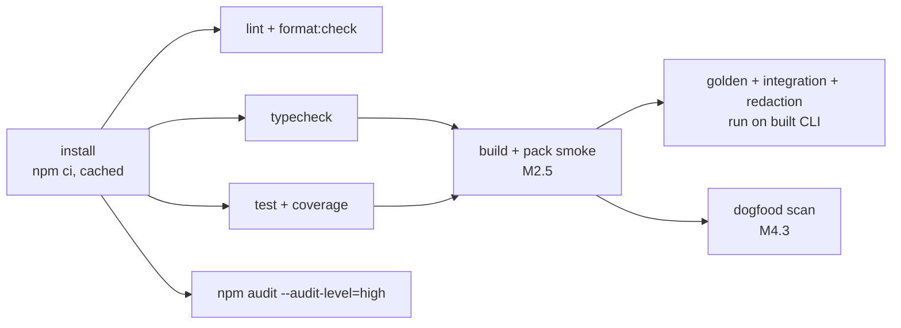

# CI/CD

> Implements the CI rows of [PRD §8 Technology](../prd.md#8-architecture), [§18](../prd.md#18-qa-strategy) and [§19](../prd.md#19-delivery-plan). Release mechanics are in [release.md](release.md).

## 1. Workflows by milestone

| Workflow file | Trigger | Introduced | Purpose |
|---|---|---|---|
| `.github/workflows/ci.yml` | `push` to `main`, `pull_request` | M0.0 | lint, format check, typecheck, test + coverage, `npm audit --audit-level=high` |
| `ci.yml` + `build` job | same | M2.5 | `npm run build` (tsup), `npm pack`, smoke-test the tarball with `npx <tarball> --version` |
| `.github/workflows/dogfood.yml` | `pull_request`, `push` to `main` | M4.3 | run the built CLI (or the local Action `uses: ./packages/action`) on this repo; must exit 0 |
| `.github/workflows/release.yml` | push of tag `v*.*.*` | M7.1 | build, full test, publish to npm with provenance, attach the tarball to the GitHub release, move the `v0` tag |
| Demo repo workflow | in the public demo repo, not here | M4.2 | `uses: <gh-user>/envdrift@v0` on a PR to prove J2 |

## 2. Job graph

Notes:
- Until M2.5 there is no build. `test` runs the unit tests only.
- From M2.5, golden, integration and redaction tests need `dist/`. Either the test job runs `npm run build` first or it depends on `build`, which uploads `dist/` as an artifact. Proposal: build inside the test job. This is simpler, and the build takes only a few seconds.

## 3. Matrix

| Dimension | Values | Status |
|---|---|---|
| Node on `ubuntu-latest` | 20, 22, 24 | PRD D10 (Node ≥ 20) |
| OS for path portability (NFR-PORT-01) | `windows-latest`, `macos-latest` on Node 22 only | **Proposal**. It keeps minutes low while still proving `/` path normalisation and fingerprint stability. |

Lint, format and audit run once (ubuntu, Node 22). Typecheck and test run on the full matrix.

## 4. Caching

- `actions/setup-node` with `cache: npm`, keyed on `package-lock.json`.
- Install with `npm ci` only, never `npm install`, so the lockfile is enforced (SEC-06).
- No caching of build output between runs. Builds are fast and stale `dist/` is a correctness risk.

## 5. Required checks and branch protection (suggested)

Proposal for `main` once the repo is on GitHub:
- Require PRs. Required checks: `lint`, `typecheck (20/22/24)`, `test (20/22/24)`, `audit`. From M2.5 add `build`; from M4.3 add `dogfood`.
- Require linear history (keeps the Git history readable for the ZIP submission).
- Disallow force-push to `main`.

As an individual entry, Rahul may push directly to `main`. CI still runs on every push.

## 6. Permissions and secrets

| Workflow | `permissions:` | Secrets |
|---|---|---|
| `ci.yml` | `contents: read` | none |
| `dogfood.yml` | `contents: read`; add `pull-requests: write` only if the dogfood run also posts a comment | none |
| `release.yml` | `contents: write` (release and tags), `id-token: write` (npm provenance or trusted publishing) | `NPM_TOKEN`, **or** none if npm trusted publishing (OIDC) is configured. Trusted publishing is preferred. |

No AWS credentials are used in this repo's CI. The SSM adapter is tested with `aws-sdk-client-mock`. The AWS OIDC example lives only in the docs ([github-action.md](../functional/github-action.md)).

## 7. Failure policy

- A red CI on `main` blocks the next milestone task until it is fixed.
- `npm audit` high or critical: upgrade or replace the dependency. If there is no fix, document an accepted risk in [dependencies.md](../architecture/dependencies.md) with an expiry date. Never disable the job.
- Flaky tests are fixed or deleted, never retried automatically.
